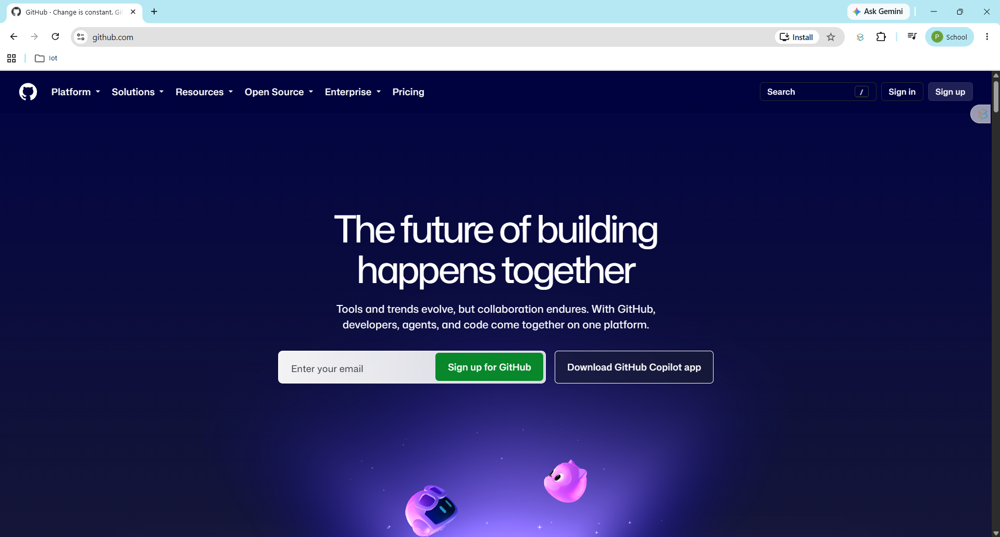

# Smart Farm Lab: ESP32 → MQTT → Node-RED → InfluxDB → Dashboard

คู่มือปฏิบัติสำหรับนักศึกษา 

เมื่อทำครบ ทุกขั้นตอนนักศึกษาจะอ่านอุณหภูมิและความชื้นจาก DHT22 ส่งข้อมูลทุกประมาณ 5 วินาที แสดงผลบน Dashboard เก็บข้อมูลย้อนหลัง และส่งคำสั่งควบคุมรีเลย์กลับไปยัง ESP32 ได้

## 1. เตรียมอุปกรณ์และโปรแกรม

อุปกรณ์ที่ใช้:

- ESP32 DOIT DevKit V1 และสาย USB ที่รับส่งข้อมูลได้
- DHT22, จอ LCD I2C 20×4 ที่อยู่ `0x27`, รีเลย์ 2 ช่อง และปุ่มกด
- Breadboard และสายเชื่อมต่อ
- คอมพิวเตอร์ Windows และ Wi-Fi 2.4 GHz ที่ ESP32 เข้าถึงคอมพิวเตอร์ได้

ติดตั้งโปรแกรมให้ครบก่อนเริ่ม:

1. Docker Desktop พร้อม WSL2 แล้วเปิด Docker Desktop ให้ Engine ทำงาน
2. Visual Studio Code และส่วนขยาย **PlatformIO IDE**
3. MQTT Explorer สำหรับตรวจข้อความและทดลองส่งคำสั่ง
4. เว็บเบราว์เซอร์
5. ต้องทำการสมัครสมาชิก github ก่อน https://github.com/


ใช้เครือข่ายเดียวกันสำหรับคอมพิวเตอร์และ ESP32 หลีกเลี่ยง Guest Wi-Fi ที่แยกอุปกรณ์ออกจากกัน Internet ของ มหาวิทยาลัยมี Firewall หากไม่ได้ขอเปิดการเชื่อมต่อ port จะเชื่อมต่อไม่ได้

## 2. เปิดโปรเจกต์และทำความเข้าใจพอร์ต

1. เปิด VS Code เลือก **File → Open Folder** แล้วเลือกโฟลเดอร์โปรเจกต์นี้
2. เปิด **Terminal → New Terminal** เป็น PowerShell
3. ตรวจว่า Terminal อยู่ในโฟลเดอร์ที่มี `docker-compose.yml` และ `platformio.ini`

ตัวอย่างสำหรับเครื่องในห้องปฏิบัติการนี้ หากเก็บโปรเจกต์ไว้ที่อื่นให้เปลี่ยนเส้นทาง:

```powershell
cd D:\code_iot\ESP32_data_vistual
docker version
```

**ผลที่ต้องได้:** `docker version` แสดงทั้ง Client และ Server ถ้าไม่มี Server ให้เปิด Docker Desktop และรอจนพร้อมก่อน

ไฟล์หลัก:

| ไฟล์ | หน้าที่ |
|---|---|
| `docker-compose.yml` | เปิด Mosquitto, InfluxDB, Node-RED และ Grafana |
| `src/main.cpp` | โปรแกรม ESP32 และค่าการเชื่อมต่อ MQTT |
| `platformio.ini` | รุ่นบอร์ด ไลบรารี และความเร็ว Serial Monitor |
| `std_lab_data/mosquitto/config/mosquitto.conf` | ตั้งค่า MQTT Broker |
| `docs/node-red-flow.json` | Flow ตัวอย่างสำหรับนักศึกษานำเข้า Node-RED |
| `std_lab_data/nodered/flows.json` | Flow ที่ Node-RED บันทึกขณะใช้งาน |
| `std_lab_data/` | ข้อมูลถาวรของบริการ ห้ามลบระหว่างทำ Lab |
| `.gitignore` | กำหนดไฟล์และข้อมูลที่ Git ไม่ต้องติดตาม |

### การตั้งค่า `.gitignore`

ไฟล์ `.gitignore` ใช้ระบุไฟล์ที่ Git ควรละเว้น เพื่อไม่ให้ไฟล์ build, ไฟล์เฉพาะเครื่อง และข้อมูล runtime ถูกเพิ่มเข้า repository โดยไม่ตั้งใจ รายการที่ตั้งค่าไว้ในโปรเจกต์นี้มีดังนี้:

| รูปแบบที่ละเว้น | คำอธิบาย |
|---|---|
| `.pio` | ไฟล์ build และผลลัพธ์จาก PlatformIO ซึ่งสร้างใหม่ได้ |
| `.vscode/.browse.c_cpp.db*` | ฐานข้อมูลสำหรับค้นหาและเรียกดูโค้ด C/C++ ที่ VS Code สร้างขึ้น |
| `.vscode/c_cpp_properties.json` | การตั้งค่า IntelliSense C/C++ ที่อาจแตกต่างกันในแต่ละเครื่อง |
| `.vscode/launch.json` | การตั้งค่าเปิดโปรแกรม Debug ซึ่งอาจเฉพาะกับเครื่องหรือวิธี Debug ของผู้ใช้ |
| `.vscode/ipch` | ไฟล์แคชของ IntelliSense ที่สร้างใหม่ได้ |
| `/std_lab_data/mosquitto/data/`, `/std_lab_data/mosquitto/log/` | ข้อมูลและ log ที่ Mosquitto สร้างระหว่างทำงาน |
| `/std_lab_data/influxdb/` | ฐานข้อมูล InfluxDB ที่เก็บข้อมูล runtime |
| `/std_lab_data/grafana/` | ข้อมูลและการตั้งค่าที่ Grafana สร้างหรือเปลี่ยนระหว่างใช้งาน |
| `/std_lab_data/nodered/.config.*` | ไฟล์ตั้งค่าภายในของ Node-RED |
| `/std_lab_data/nodered/*.backup` | ไฟล์สำรองที่ Node-RED สร้างขึ้น |
| `/std_lab_data/nodered/flows_cred.json` | ข้อมูล credentials ของ Node-RED ซึ่งอาจมีข้อมูลลับ |
| `/std_lab_data/nodered/node_modules/` | แพ็กเกจ Node.js ที่ติดตั้งสำหรับ Node-RED และติดตั้งใหม่ได้ |

เครื่องหมาย `/` นำหน้ารูปแบบข้อมูลใน `std_lab_data` หมายถึงให้จับคู่จากโฟลเดอร์หลักของ repository ส่วนรูปแบบ `.vscode/...` และ `.pio` ใช้กับรายการที่ระบุในโปรเจกต์นี้เท่านั้น ทั้งนี้ `.gitignore` มีผลกับไฟล์ที่ Git ยังไม่ได้ติดตาม หากไฟล์ถูกเพิ่มเข้า Git ไปแล้ว การเพิ่มชื่อไฟล์ใน `.gitignore` อย่างเดียวจะไม่หยุดติดตามไฟล์นั้น

พอร์ตที่ใช้ในโปรเจกต์ปัจจุบัน:

| บริการ | จากคอมพิวเตอร์/ESP32 | ระหว่าง container |
|---|---|---|
| MQTT | `<SERVER_IP>:11883` | `std-mosquitto:1883` |
| Node-RED Editor | `http://localhost:11880` | `std-nodered:1880` |
| Node-RED Dashboard | `http://localhost:11880/ui` | — |
| InfluxDB | `http://localhost:8086` | `http://std-influxdb:8086` |
| Grafana | `http://localhost:3000` | `std-grafana:3000` |

`<SERVER_IP>` หมายถึง IPv4 ของคอมพิวเตอร์ที่เปิด Docker ไม่ใช่ IP ของ ESP32 ส่วน `localhost` ใช้เมื่อเปิดเว็บบนคอมพิวเตอร์เครื่องนั้น หากเปิดจากเครื่องอื่นให้แทนด้วย `<SERVER_IP>`

รูปแบบพอร์ตใน Compose คือ `HOST:CONTAINER` เช่น `11883:1883` หมายความว่า ESP32 ใช้ `11883` แต่ Node-RED ภายใน Docker ใช้ `1883` อย่าเปลี่ยนพอร์ตทั้งสองฝั่งให้เหมือนกันโดยอัตโนมัติ

## 3. ตรวจ MQTT Broker และเปิด Server

1. เปิด `std_lab_data/mosquitto/config/mosquitto.conf` ตรวจว่ามีค่าต่อไปนี้ โดยชื่อไฟล์ต้องไม่ลงท้ายด้วย `.txt`:

```conf
listener 1883 0.0.0.0
protocol mqtt
allow_anonymous true
persistence true
persistence_location /mosquitto/data/
log_dest stdout
log_dest file /mosquitto/log/mosquitto.log
```

การเชื่อมต่อแบบไม่ใช้บัญชีนี้ใช้สำหรับเครือข่าย Lab ที่ควบคุมได้

2. ตรวจ `docker-compose.yml` ว่า Mosquitto ใช้ `11883:1883` และ Node-RED ใช้ `11880:1880`
3. รันคำสั่งในโฟลเดอร์โปรเจกต์:

```powershell
docker compose config --quiet
docker compose up -d
docker compose ps -a
```

ครั้งแรกต้องใช้อินเทอร์เน็ตเพื่อดาวน์โหลด image และอาจใช้เวลาหลายนาที

**ผลที่ต้องได้:** `std-mosquitto`, `std-influxdb`, `std-nodered` และ `std-grafana` เป็น `Up` หรือ `running` ทั้งหมด หากเป็น `Created`, `Exited` หรือ `Restarting` ให้ดูหัวข้อแก้ปัญหาท้ายคู่มือ

4. ทดลองเปิด Node-RED ที่ `http://localhost:11880` และ InfluxDB ที่ `http://localhost:8086`

## 4. ตั้งค่า InfluxDB และสร้าง Token

ทำขั้นตอนนี้ก่อนตั้งค่าโหนดบันทึกข้อมูลใน Node-RED

1. เปิด `http://localhost:8086`
2. ถ้าเป็นเครื่องใหม่ เลือก **Get Started** และตั้งค่าดังนี้:

| รายการ | ค่าที่ใช้ |
|---|---|
| Username | ตั้งชื่อบัญชีของนักศึกษาเอง |
| Password | ตั้งรหัสผ่านและเก็บไว้ |
| Organization | `lab` |
| Bucket | `smartfarm` |

3. ถ้าหน้าจอเป็นหน้า Login แสดงว่าฐานข้อมูลถูกตั้งค่าแล้ว ให้ใช้บัญชีเดิม ตรวจ Organization และ Bucket ที่มีอยู่ อย่าลบโฟลเดอร์ฐานข้อมูลเพื่อเริ่มใหม่
4. ไปที่ **Load Data → API Tokens** แล้วสร้าง **Custom API Token** ให้มีสิทธิ์อ่านและเขียน Bucket `smartfarm` สำหรับ Node-RED
5. คัดลอก Token เก็บไว้ในที่ส่วนตัว ต้องนำไปใส่ใน Node-RED ห้ามนำ Token ไปใส่ในรายงานหรือ commit ลง Git
6. สร้าง Token อีกตัวที่อ่าน `smartfarm` ได้ สำหรับ Grafana

ถ้าใช้ Organization หรือ Bucket ชื่ออื่น ต้องเปลี่ยนค่าใน Node-RED, Grafana และตัวอย่าง query ในคู่มือนี้ให้ตรงกัน

**ผลที่ต้องได้:** มี Bucket `smartfarm` และมี Token สำหรับการเขียนข้อมูล ข้อมูลยังไม่จำเป็นต้องปรากฏจนกว่าจะเปิด ESP32 และ Deploy Flow

## 5. ต่อวงจร ESP32

ถอดสาย USB ก่อนต่อวงจร และใช้ GND ร่วมกันสำหรับวงจรสัญญาณ

| อุปกรณ์/สัญญาณ | ขา ESP32 | หมายเหตุ |
|---|---|---|
| DHT22 DATA | GPIO 15 | เซนเซอร์เปล่าใช้ตัวต้านทาน pull-up DATA ไป 3.3 V ประมาณ 4.7–10 kΩ; โมดูลอาจมีอยู่แล้ว |
| DHT22 VCC / GND | 3.3 V / GND | ตรวจลำดับขาจากอุปกรณ์จริง |
| รีเลย์ช่องปั๊ม IN | GPIO 14 | ตรวจว่าโมดูลรับสัญญาณ 3.3 V ได้ |
| รีเลย์ช่องวาล์ว IN | GPIO 27 | จ่ายไฟโมดูลตามพิกัด ไม่จ่ายไฟโหลดจาก GPIO |
| ปุ่มตั้งค่า Wi-Fi | GPIO 4 กับ GND | โปรแกรมใช้ `INPUT_PULLUP`; กดแล้วเป็น LOW |
| LCD SDA / SCL | GPIO 21 / GPIO 22 | ขา I2C เริ่มต้นของบอร์ดที่ใช้ |
| LCD VCC / GND | ตามพิกัดโมดูล / GND | หากวงจร I2C ดึงสัญญาณขึ้น 5 V ให้ใช้ตัวแปลงระดับสัญญาณก่อนเข้า ESP32 |

ทดสอบรีเลย์ด้วย LED หรือโหลดแรงดันต่ำก่อน โปรแกรมเขียน `state` ลง GPIO โดยตรง: `1` เป็น HIGH และ `0` เป็น LOW รีเลย์แบบ Active LOW จึงอาจเปิดเมื่อส่ง `0` ต้องตรวจรุ่นจริงก่อนต่อปั๊มหรือวาล์ว

## 6. ตั้งค่าโปรแกรมและอัปโหลดลง ESP32

1. ใน PowerShell รัน:

```powershell
ipconfig
```

2. จด **IPv4 Address ของ Wi-Fi หรือ Ethernet ที่ใช้งานจริง** อย่าใช้ IP ของอะแดปเตอร์ `vEthernet`, Docker หรือ WSL
3. เปิด `src/main.cpp` และแก้ค่าตามเครื่องของตนเอง เช่น:

```cpp
const char* mqtt_server = "192.168.1.72"; // เปลี่ยนเป็น IPv4 ของเครื่องที่เปิด Docker
const int mqtt_port = 11883;

String site_id = "site_01";
String zone_id = "zone_A";
String device_id = "node_01";
```

ถ้ามีหลายบอร์ดใช้ Broker เดียวกัน ต้องให้ `device_id` ไม่ซ้ำ เช่น `node_02` และเปลี่ยน Topic ที่รับ/ส่งใน MQTT Explorer และ Node-RED ให้ตรงด้วย

4. บันทึกไฟล์ เสียบ ESP32 ผ่าน USB แล้วรอ PlatformIO ติดตั้งแพ็กเกจตาม `platformio.ini`
5. เปิด **PlatformIO → Project Tasks → esp32doit-devkit-v1 → General → Build**
6. เมื่อ Build เป็น `SUCCESS` เลือก **Upload**
7. เปิด **Monitor** ที่ความเร็ว **115200 baud** หาก Upload ไม่พบพอร์ต ให้ตรวจสาย USB, Device Manager และไดรเวอร์ USB ของบอร์ด

หากใช้ PlatformIO Core CLI ให้รันผ่าน PlatformIO Terminal:

```powershell
pio run
pio run --target upload
pio device monitor --baud 115200
```

หากคำสั่ง `pio` ไม่ถูกพบ ใช้ Project Tasks ใน VS Code ได้โดยไม่ต้องแก้ PATH ปิด Serial Monitor ก่อนอัปโหลดครั้งถัดไปถ้ามีพอร์ตถูกใช้งานอยู่

**ผลที่ต้องได้:** Build และ Upload สำเร็จ Serial Monitor แสดง `Smart Farm starting...`

## 7. เชื่อมต่อ Wi-Fi และตรวจ MQTT

1. หาก ESP32 ยังไม่มี Wi-Fi ที่บันทึกไว้ ให้ใช้มือถือหรือคอมพิวเตอร์เชื่อม Wi-Fi ชื่อ **SmartFarm_Setup**
2. เปิดหน้าตั้งค่า หากไม่เปิดอัตโนมัติ ให้เข้า `http://192.168.4.1`
3. เลือก Wi-Fi 2.4 GHz ที่เข้าถึง Server ได้ ใส่รหัสผ่านแล้วบันทึก
4. หลังตั้งค่า ให้มือถือ/คอมพิวเตอร์กลับมาเชื่อมเครือข่ายปกติ
5. ตรวจ Serial Monitor:

```text
[WiFi] Connected. IP=...
[MQTT] Broker=192.168.1.72:11883, client=node_01
[MQTT] Connected.
[MQTT] Telemetry publish OK: ...
```

IP ใน log ต้องตรงกับเครื่องของนักศึกษา หากจะเปลี่ยน Wi-Fi ภายหลัง ให้กดปุ่ม GPIO 4 เพื่อเปิดหน้า SmartFarm_Setup อีกครั้ง โปรแกรมปัจจุบันเปิด portal นานสูงสุด 180 วินาทีเมื่อเข้าโหมดนี้จากปุ่ม

6. เปิด MQTT Explorer สร้าง Connection:

| รายการ | ค่า |
|---|---|
| Protocol | MQTT แบบไม่ใช้ TLS |
| Host | IPv4 ของ Server |
| Port | `11883` |
| Username / Password | เว้นว่าง |

7. กด Connect และตรวจ Topic สำหรับ `node_01`:

| Topic | การใช้งาน |
|---|---|
| `smart_farm/site_01/zone_A/node_01/telemetry` | ค่าเซนเซอร์ทุกประมาณ 5 วินาที |
| `smart_farm/site_01/zone_A/node_01/status` | สถานะ `online` / `offline` แบบ retained |
| `smart_farm/site_01/zone_A/node_01/cmd` | ส่งคำสั่งจากผู้ใช้ไปยัง ESP32 |
| `smart_farm/site_01/zone_A/node_01/ack` | ESP32 ตอบรับคำสั่ง |

ตัวอย่าง Telemetry:

```json
{"temperature":28.5,"humidity":65.2,"pump_state":0,"valve_state":0}
```

8. ใช้ช่อง Publish ของ MQTT Explorer ส่งไปที่ Topic `smart_farm/site_01/zone_A/node_01/cmd` เลือกข้อความ JSON และ **ปิด Retain**:

```json
{"cmd":"pump","state":1}
```

**ผลที่ต้องได้:** GPIO 14 เปลี่ยนเป็น HIGH และ Topic `ack` มี `{"ack":"pump","state_set":1}` ทดลองส่ง `state:0` เพื่อกลับเป็น LOW และเปลี่ยน `cmd` เป็น `valve` เพื่อทดสอบ GPIO 27

## 8. เตรียม Flow ใน Node-RED

1. เปิด `http://localhost:11880`
2. ไปที่เมนู **☰ → Manage palette → Install** ตรวจว่ามีแพ็กเกจต่อไปนี้ หากยังไม่มีให้ติดตั้ง:
   - `node-red-dashboard` สำหรับ Dashboard แบบคลาสสิกที่ Flow นี้ใช้
   - `node-red-contrib-influxdb` สำหรับบันทึกข้อมูล
3. หากมี Flow ชื่อ Smart Farm และโหนด `Router & Influx Format` อยู่แล้ว ให้ใช้ Flow เดิมและไปขั้นตอนที่ 9 ไม่ต้อง Import ซ้ำ
4. หากยังไม่มี Flow เลือก **☰ → Import → select a file to import** เลือก [docs/node-red-flow.json](docs/node-red-flow.json) แล้ว Import
5. หากมีตัวเลือก ให้นำเข้าเป็น Flow ใหม่ ตรวจว่ามี MQTT In, Function, InfluxDB Out, Gauge, Text และ Switch ครบ ไม่มีโหนด unknown

ใช้ไฟล์ `docs/node-red-flow.json` สำหรับนำเข้า ไม่คัดลอก JSON ยาวจาก `instruction.md` เพราะตัวอย่างในไฟล์นั้นมีอักขระ escape จากการจัดรูปแบบเอกสาร ไฟล์ตัวอย่างไม่มี Token ให้ตั้ง Token ของตนเองในขั้นตอนถัดไป

Flow ตัวอย่างนี้มี Debug 2 จุด: **debug 1** รับข้อความจาก MQTT In เพื่อดู Topic และ payload และ **debug 2** รับคำสั่งจาก Switch ทั้งสองเพื่อดู JSON ที่ส่งไปควบคุม ESP32 เปิด Debug sidebar เพื่อดูผล และปิด Debug nodes ได้เมื่อทดสอบเสร็จ ทั้งสองจุดไม่ได้ต่อจาก InfluxDB จึงไม่ใช่หลักฐานว่าบันทึกฐานข้อมูลสำเร็จ

## 9. ตั้งค่าการเชื่อมต่อใน Node-RED และ Deploy

1. ดับเบิลคลิกโหนด **MQTT In** แล้วกดปุ่มดินสอข้าง Server ตั้งค่า Broker:

| รายการ | ค่า |
|---|---|
| Server | `std-mosquitto` |
| Port | `1883` |
| TLS | ไม่เปิดสำหรับ Lab นี้ |
| Username / Password | เว้นว่าง |
| Client ID | เว้นว่างให้สร้างอัตโนมัติ หรือกำหนดชื่อที่ไม่ซ้ำกับ ESP32 |

2. ตั้ง Topic เป็น `smart_farm/site_01/zone_A/node_01/#` และ Output เป็น **a parsed JSON object** ให้ MQTT Out ใช้ Broker เดียวกัน
3. ดับเบิลคลิก **Save to InfluxDB** แล้วแก้ Server configuration ด้วยปุ่มดินสอ:

| รายการ | ค่า |
|---|---|
| Version | `2.0` |
| URL | `http://std-influxdb:8086` |
| Token | Token ที่เขียน Bucket `smartfarm` ได้จากขั้นตอนที่ 4 |

4. ในโหนด **Save to InfluxDB** ตั้ง **Organization = `lab`**, **Bucket = `smartfarm`** และ Precision เป็น `ms` โดย Flow กำหนด measurement เป็น `sensor_data` ผ่าน `msg.measurement`
5. ตรวจ Function **Router & Influx Format** ว่ามี Outputs จำนวน **3** และต่อสายดังนี้:

| Output | ต่อไปที่ | ข้อมูล |
|---|---|---|
| 1 | Save to InfluxDB | `msg.payload = [fields, tags]` |
| 2 | Temperature และ Humidity Gauge | JSON ค่าเซนเซอร์ |
| 3 | Device Status Text | ข้อความ online/offline |

Fields ที่บันทึกคือ `temperature`, `humidity`, `pump`, `valve` และ Tags คือ `site`, `zone`, `device`

6. ตรวจ Switch **Pump Control** และ **Valve Control** ว่าส่ง Topic `smart_farm/site_01/zone_A/node_01/cmd` และค่า On/Off เป็นชนิด **JSON**:

| Switch | On | Off |
|---|---|---|
| Pump | `{"cmd":"pump","state":1}` | `{"cmd":"pump","state":0}` |
| Valve | `{"cmd":"valve","state":1}` | `{"cmd":"valve","state":0}` |

MQTT Out ต้องไม่เปิด Retain สำหรับคำสั่งควบคุม

7. กด **Done** และ **Deploy** เปิด Debug sidebar ตรวจว่าไม่มี error หากต้องการตรวจข้อมูล ให้เพิ่ม Debug node ต่อจาก Output 1 ชั่วคราว

**ผลที่ต้องได้:** MQTT nodes แสดง connected และไม่มี `401 unauthorized` จาก InfluxDB

## 10. ทดสอบ Dashboard และข้อมูลย้อนหลัง

1. เปิด `http://localhost:11880/ui`
2. ตรวจเกจ Temperature และ Humidity ว่าเปลี่ยนตามค่า DHT22 และ Device Status เป็น `online`
3. สับสวิตช์ Pump/Valve แล้วตรวจรีเลย์พร้อมกับข้อความ `ack` ใน MQTT Explorer
4. เปิด InfluxDB → **Data Explorer** เลือก Bucket `smartfarm`, measurement `sensor_data` และ field `temperature` หรือ `humidity` เลือกช่วงเวลา 15 นาทีล่าสุดแล้วกด Submit

หากใช้ Script Editor สามารถใช้ Flux นี้:

```flux
from(bucket: "smartfarm")
  |> range(start: -15m)
  |> filter(fn: (r) => r._measurement == "sensor_data")
  |> filter(fn: (r) => r._field == "temperature" or r._field == "humidity")
  |> filter(fn: (r) => r.device == "node_01")
```

5. ถอดไฟ ESP32 แล้วรอ Broker ตรวจพบการขาดการเชื่อมต่อ สถานะจะเปลี่ยนเป็น `offline` ผ่าน LWT ซึ่งไม่จำเป็นต้องเปลี่ยนทันที เสียบไฟกลับแล้วตรวจ `online` อีกครั้ง

**ผลที่ต้องได้:** มีข้อมูลใหม่ในฐานข้อมูล Dashboard แสดงค่า และสั่ง GPIO ได้ หากไม่มีข้อมูลให้แก้ปัญหาก่อนเริ่ม Grafana

## 11. สร้างกราฟใน Grafana

1. เปิด `http://localhost:3000` หากเป็นระบบใหม่ที่ยังไม่เปลี่ยนค่า ใช้ `admin` / `admin` แล้วตั้งรหัสผ่านใหม่ หากมีข้อมูลเดิมให้ใช้บัญชีเดิม
2. ไปที่ **Connections → Data sources → Add data source** เลือก **InfluxDB** ชื่อเมนูอาจต่างเล็กน้อยตามเวอร์ชัน
3. ตั้งค่าดังนี้:

| รายการ | ค่า |
|---|---|
| Query language | Flux |
| URL | `http://std-influxdb:8086` |
| Organization | `lab` |
| Token | Token ที่อ่าน Bucket `smartfarm` ได้ |
| Default Bucket | `smartfarm` |

4. กด **Save & test** ให้การเชื่อมต่อสำเร็จ
5. สร้าง Dashboard ใหม่ เพิ่ม Visualization เลือก data source ที่สร้าง แล้ววาง query:

```flux
from(bucket: "smartfarm")
  |> range(start: v.timeRangeStart, stop: v.timeRangeStop)
  |> filter(fn: (r) => r._measurement == "sensor_data")
  |> filter(fn: (r) => r._field == "temperature")
  |> filter(fn: (r) => r.device == "node_01")
  |> aggregateWindow(every: v.windowPeriod, fn: mean, createEmpty: false)
```

6. ตั้งชื่อกราฟ Temperature เลือกหน่วย Celsius บันทึก Dashboard แล้วเพิ่มกราฟ Humidity โดยเปลี่ยน field เป็น `humidity` และหน่วยเป็น Percent (0–100)
7. ตั้งช่วงเวลาเป็น 15 นาทีล่าสุดและ Refresh ประมาณ 5–10 วินาที

**ผลที่ต้องได้:** Grafana แสดงกราฟจากข้อมูลเดียวกับที่ตรวจใน InfluxDB

## 12. วิธีเปิดใช้งานครั้งถัดไปและปิดเมื่อเลิกเรียน

เมื่อกลับมาใช้งาน:

1. เปิด Docker Desktop รอให้ Engine พร้อม
2. เปิด Terminal ในโฟลเดอร์โปรเจกต์แล้วรัน:

```powershell
docker compose up -d
docker compose ps -a
```

3. ตรวจ IPv4 ของ Server หากเปลี่ยน ให้แก้ `mqtt_server` และ Upload ลง ESP32 ใหม่
4. จ่ายไฟ ESP32 แล้วเปิด Dashboard ไม่ต้องสร้างบัญชี InfluxDB หรือ Import Flow ใหม่

เมื่อเลิกเรียน ให้ปิดโหลดทดลองก่อน แล้วหยุดบริการ:

```powershell
docker compose stop
```

คำสั่งนี้เก็บ container และข้อมูลไว้ ส่วน `docker compose down` ลบ container/network ของโปรเจกต์ แต่ข้อมูลที่ bind mount ใน `std_lab_data/` ยังอยู่ ห้ามลบโฟลเดอร์นี้หากต้องการเก็บฐานข้อมูล Flow และ Dashboard

## 13. แก้ปัญหาที่พบบ่อย

### Docker เชื่อมต่อ Engine ไม่ได้

เปิด Docker Desktop และรอจนพร้อม จากนั้นตรวจ `docker version` หากพบ permission denied ให้ตรวจสิทธิ์เข้าถึง Docker ของ Terminal นั้นก่อน สถานะ error จากเครื่องมือที่จำกัดสิทธิ์ไม่ได้แปลว่า Engine หยุดเสมอไป

### เปิด container ไม่ได้: ports are not available / forbidden by its access permissions

ตรวจบริการที่มีปัญหาและช่วงพอร์ตที่ Windows สงวนไว้:

```powershell
docker compose ps -a
netsh interface ipv4 show excludedportrange protocol=tcp
Get-NetTCPConnection -LocalPort 11883 -ErrorAction SilentlyContinue
```

แม้ไม่มีโปรแกรมฟังพอร์ตอยู่ Windows ก็อาจสงวนพอร์ตนั้นไว้ได้ ในเครื่องที่ใช้ทำคู่มือนี้เคยสงวนช่วง `1823–1922` ทำให้ `1883`, `1884` และ `1880` ใช้ไม่ได้ จึงเปลี่ยนมาใช้ `11883` และ `11880` ช่วงที่สงวนอาจเปลี่ยนหลังรีสตาร์ต ให้ตรวจเครื่องจริงเสมอ

หากต้องเปลี่ยนอีก ให้เลือกพอร์ตที่ไม่ถูกใช้หรือสงวน เปลี่ยนเลขฝั่ง Host ใน Compose และเปลี่ยน `mqtt_port` ใน ESP32 พร้อม Upload ใหม่ ส่วนพอร์ตภายใน Mosquitto และ Node-RED Broker configuration ยังเป็น `1883`

การหยุด WinNAT ชั่วคราวเป็นทางเลือกสำหรับเครื่อง Lab ที่ผู้ดูแลอนุญาต ให้เปิด PowerShell แบบ Administrator แล้วรันทีละบรรทัด:

```powershell
net stop winnat
docker compose up -d
net start winnat
```

วิธีนี้อาจปลดการสงวนพอร์ตที่เกี่ยวกับ WinNAT แต่ไม่รับประกันผล และเครือข่ายเสมือนอาจสะดุด ต้องเปิด WinNAT กลับแม้คำสั่ง Compose ล้มเหลว วิธีหลักของคู่มือนี้คือใช้พอร์ตที่ตรวจแล้วว่าว่าง

### ESP32 เชื่อมต่อ MQTT ไม่ได้

ตรวจตามลำดับ: Wi-Fi เชื่อมต่อแล้ว → Server IP ถูกต้อง → container Mosquitto ทำงาน → ESP32 ใช้ `11883` → Windows Firewall อนุญาต TCP พอร์ตนี้บนเครือข่าย Lab → เครือข่ายไม่แยกอุปกรณ์

จากคอมพิวเตอร์อีกเครื่องในเครือข่ายเดียวกัน ทดสอบโดยแทน IP ให้ตรงกับ Server:

```powershell
Test-NetConnection 192.168.1.72 -Port 11883
```

ต้องได้ `TcpTestSucceeded : True` ไม่ใช้ `localhost` เป็น Broker address ใน ESP32

### Node-RED บันทึก InfluxDB ไม่ได้: 401 unauthorized

ตรวจ Token ว่าถูกต้อง ยังไม่ถูกยกเลิก และเขียน Bucket ที่เลือกได้ ตรวจ Organization/Bucket ให้ตรงกับ InfluxDB แล้วกด Deploy ใหม่ รหัสผ่านหน้า Login ไม่ใช่ API Token และการ Restart container ไม่ได้แก้ Token ที่ผิด

### Dashboard ไม่มีค่า / Node-RED มีโหนด unknown

ตรวจการติดตั้ง `node-red-dashboard` และ `node-red-contrib-influxdb` ตรวจ MQTT In ให้ Output เป็น JSON object ตรวจ Topic ให้ตรงกับ device_id และตรวจสายทั้ง 3 Output ของ Function จากนั้น Deploy

### DHT อ่านค่าไม่ได้ / LCD ไม่แสดงผล / รีเลย์ทำงานกลับด้าน

- `[DHT] Read failed`: ตรวจ GPIO 15, ไฟเลี้ยง, GND และ pull-up
- LCD: ตรวจ SDA/SCL และที่อยู่ I2C ซึ่งโปรแกรมกำหนด `0x27` ขนาด 20×4
- รีเลย์: ตรวจว่า Active HIGH หรือ Active LOW ค่าใน telemetry คือระดับ GPIO ไม่ใช่การยืนยันว่าโหลดทำงานจริง

ดู log ของบริการเมื่อต้องวิเคราะห์เพิ่มเติม:

```powershell
docker compose logs --tail 50 std-mosquitto
docker compose logs --tail 50 std-nodered
docker compose logs --tail 50 std-influxdb
```

คำเตือน `version is obsolete` ใน Compose ไม่ใช่สาเหตุที่ container สตาร์ตไม่ได้

## 14. การส่งงาน ให้ตรวจสอบการทำงานของระบบทั้งหมด ต้องสามารถ ทำได้ ดังรายการดังต่อไปนี้

- [ ] Container ทั้ง 4 ทำงาน และเปิดหน้าเว็บได้ตามพอร์ตในตาราง
- [ ] ESP32 เชื่อมต่อ Wi-Fi และ MQTT ได้ โดย device_id ไม่ซ้ำ
- [ ] MQTT Explorer รับ telemetry ทุกประมาณ 5 วินาที
- [ ] ส่งคำสั่ง pump/valve แล้วพบ ACK และ GPIO เปลี่ยนตามคำสั่ง
- [ ] Node-RED Dashboard แสดงค่าเซนเซอร์และสถานะ
- [ ] InfluxDB มีข้อมูล measurement `sensor_data` พร้อม tags ของบอร์ด
- [ ] Grafana แสดงกราฟ Temperature และ Humidity
- [ ] ถอดไฟ/เปิด ESP32 กลับแล้วทดสอบ offline/online ได้

หลักฐานส่งงาน: ภาพสถานะ container, Serial Monitor, MQTT telemetry/ACK, Node-RED Flow และ Dashboard, ข้อมูลใน InfluxDB และกราฟ Grafana พร้อมอธิบายเส้นทางข้อมูลและความต่างระหว่างพอร์ต Host กับ Container ปิดบังรหัสผ่านและ Token ในทุกภาพ

## เอกสารประกอบ

- [ต้นฉบับบทปฏิบัติการ](instruction.md)
- [การตั้งค่า InfluxDB 2.x](https://docs.influxdata.com/influxdb/v2/get-started/setup/)
- [โหนด Node-RED สำหรับ InfluxDB](https://flows.nodered.org/node/node-red-contrib-influxdb)
- [การตั้งค่าการเชื่อมต่อ Grafana กับ InfluxDB](https://grafana.com/docs/learning-paths/influxdb-data-source/configure-connection/)
